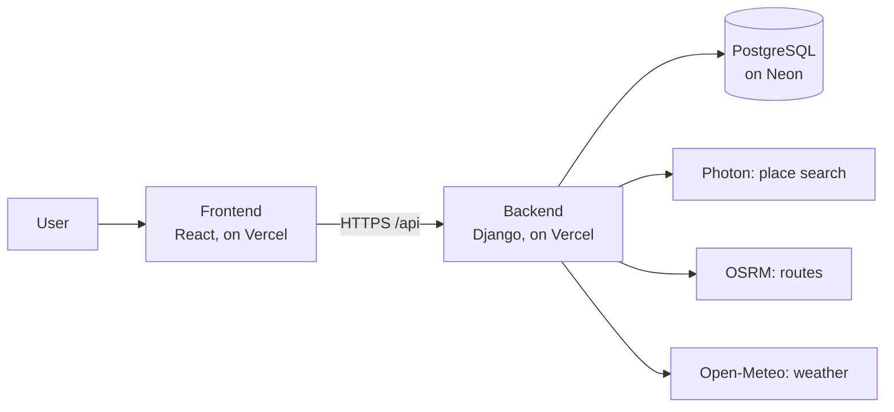

# Architecture

Two apps, each in its own repository, both deployed on Vercel:

- **Frontend:** React and TypeScript. Form, map and results.
- **Backend:** Django REST API. Routing, weather, risk and storage (PostgreSQL).

## Planning a trip

1. The user picks origin and destination from search suggestions, then sets departure time, load and sampling interval.
2. The backend gets up to 3 different routes from OSRM and caps travel speed at 65 mph for trucks.
3. It places a checkpoint every 10, 25 or 50 miles and calculates the truck's ETA at each.
4. It gets the forecast for each checkpoint at that ETA from Open-Meteo.
5. It rates each checkpoint's risk from wind, rain, snow and the truck's load. Missing data is marked unknown.
6. It totals each route's risk in miles and ranks the routes: fewest No Travel, Severe, unknown, then High miles, then lowest average risk, then shortest time.
7. It saves the trip and returns the routes, checkpoints and recommendation.

The map's weather heatmap is a separate request that loads the saved trip's routes and returns 48 hours of weather around them.

## Backend apps

| App | Role |
|---|---|
| `core` | Shared HTTP client, errors, logging |
| `geocoding` | Place search |
| `routing` | Routes and checkpoints |
| `weather` | Forecasts and heatmap |
| `risk` | Risk rules and route ranking |
| `trips` | Planning, storage and API |

## Key decisions

- **Weather at the ETA**, not the current weather, because a storm only matters if the truck is there when it hits.
- **Unknown is not safe.** Missing forecast data is never counted as Low, and routes with missing data rank below fully checked ones.
- **Rules as data.** Risk thresholds live in one file (`risk/rules.py`) and can be read and tested on their own.
- **External calls kept separate.** Risk and ranking logic don't depend on the external APIs, so they're tested without network calls.
